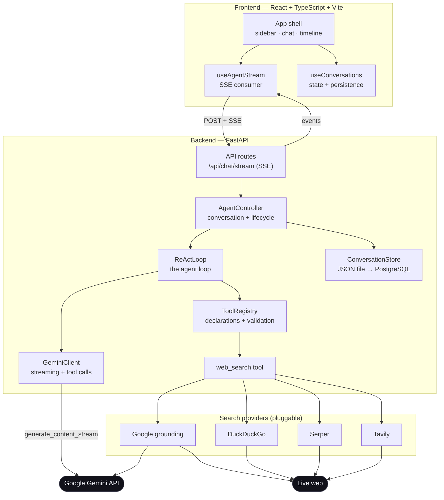
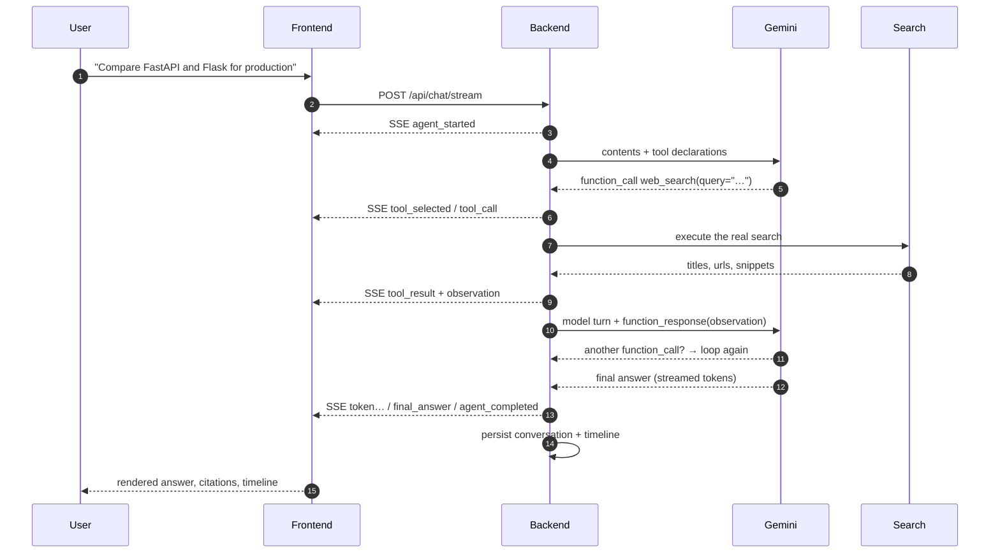

# NEXUS — ReAct Intelligence

> A production-quality ReAct agent that **reasons**, **acts** with a real web-search tool,
> **observes** the results, **iterates** when it needs more, and answers with clickable citations.
> Every stage of that loop is streamed to the browser as it happens.

  

---

## Table of contents

1. [What this is](#1-what-this-is)
2. [Features](#2-features)
3. [Screenshots](#3-screenshots)
4. [Architecture](#4-architecture)
5. [How the ReAct loop works](#5-how-the-react-loop-works)
6. [Tech stack](#6-tech-stack)
7. [Project structure](#7-project-structure)
8. [Installation](#8-installation)
9. [Configuration](#9-configuration)
10. [Running locally](#10-running-locally)
11. [Testing](#11-testing)
12. [API reference](#12-api-reference)
13. [Deployment](#13-deployment)
14. [Security](#14-security)
15. [How this satisfies the assignment](#15-how-this-satisfies-the-assignment)
16. [Troubleshooting](#16-troubleshooting)

---

## 1. What this is

**NEXUS** is a full-stack AI agent application built around a *genuine* ReAct
(Reason + Act) execution loop:

```
User query
    ↓
Gemini decides what information it needs
    ↓
Gemini requests a tool call  (web_search)
    ↓
The backend executes a REAL web search
    ↓
The results are returned to Gemini as observations
    ↓
Gemini evaluates the observations
    ├── not enough → another search (the loop continues)
    └── enough     → final answer, grounded in those observations
    ↓
The answer + sources are streamed to the UI
```

Nothing about the search is simulated. The model decides *whether* and *what* to
search, the backend performs the actual network request, and the observations it
receives are the observations the model actually saw.

> **Note on the model API surface.** Gemini only enables function calling on the
> `v1beta` API version, so the backend explicitly opts in via
> `HttpOptions(api_version="v1beta")`.

---

## 2. Features

### The agent
- **True ReAct loop** — thought → action → observation → iteration → answer.
- **Real tool calling** — Gemini requests `web_search` through Gemini's function-calling API; the backend executes it.
- **Multi-iteration reasoning** — the agent decomposes a question into several focused searches and re-searches when the first observations are thin.
- **Configurable iteration budget** — hard cap prevents infinite loops; hitting it produces an honest partial answer.
- **Validated tool arguments** — every call is validated with Pydantic before it reaches the network.
- **Graceful failure** — a failed search becomes an *observation* the model can react to, not a crash.
- **No fabrication** — the model is instructed to cite only URLs it actually observed; the UI shows the real result set.

### The search layer (pluggable)
| Provider | Needs | Notes |
| --- | --- | --- |
| `google_grounding` | `GEMINI_API_KEY` | Real Google Search via Gemini grounding. URLs are canonicalised against the live page. |
| `duckduckgo` | nothing | Keyless web search returning real titles, URLs and snippets. |
| `serper` | `SERPER_API_KEY` | Dedicated Google-results API. |
| `tavily` | `TAVILY_API_KEY` | Agent-oriented search API. |

If the configured provider is unusable (missing key, quota, outage) the agent
falls back to the keyless backend instead of failing the run.

### Streaming & events
- **Server-Sent Events** with a uniform envelope: `id`, `type`, `timestamp`, `step`, `title`, `detail`, `data`.
- Event types: `agent_started`, `planning`, `tool_selected`, `tool_call`, `tool_started`, `tool_result`, `observation`, `token`, `final_answer`, `agent_completed`, `agent_error`, `agent_cancelled`.
- Heartbeat comments keep the connection alive during long searches.
- **Cancellation** — the *Stop* button aborts the request and signals the backend to halt the run.

### The interface
- Three-pane layout: **sidebar** · **chat workspace** · **live execution timeline**.
- Animated vertical timeline with status, timestamp, description and expandable details for every stage.
- Expandable tool logs showing the **actual** search results the agent observed.
- Markdown with headings, lists, **tables**, links, blockquotes and syntax-highlighted code blocks.
- Copy response, copy code, regenerate, stop generation, toasts, skeletons, empty states and error states.
- Conversation management: new, rename, delete, clear, history and follow-up context.
- Dark theme by default with a light theme and a system option.
- Responsive down to mobile (sidebars become drawers).
- Live backend/AI connectivity indicator.

---

## 3. Screenshots

> Placeholders — drop your own captures in `docs/` and update the paths below.

| View | Image |
| --- | --- |
| Welcome screen | `docs/screenshots/welcome.png` |
| Research in progress (live timeline) | `docs/screenshots/research.png` |
| Answer with citations | `docs/screenshots/answer.png` |
| Settings | `docs/screenshots/settings.png` |
| Light theme | `docs/screenshots/light.png` |
| Mobile layout | `docs/screenshots/mobile.png` |

---

## 4. Architecture



### Request lifecycle



---

## 5. How the ReAct loop works

The loop lives in [`backend/app/agent/loop.py`](backend/app/agent/loop.py).

| Step | Code | Emitted event |
| --- | --- | --- |
| Receive the query | `AgentController.stream_run` | `agent_started` |
| Plan | `ReActLoop.run` → `llm.stream_turn` | `planning` |
| Model requests a tool | `registry.execute` | `tool_selected`, `tool_call` |
| Run the tool | `ToolRegistry.execute` → `search_tool` | `tool_started` |
| Read the observations | `ToolResult.to_model_payload` | `tool_result`, `observation` |
| Iterate | loop back to the model with the observations | `planning` (next iteration) |
| Answer | final streamed turn | `token` … `final_answer` |
| Finish | persist the turn | `agent_completed` |

**Multi-tool support.** If Gemini returns several function calls in one turn,
each one is executed, each observation is appended to the history, and all of the
responses are returned to the model in a single `function_response` turn.

**Iteration limit.** `MAX_AGENT_ITERATIONS` (default 6) bounds the loop. If the
budget is exhausted the agent returns an honest partial answer instead of
looping forever.

**Thought signatures.** Gemini 3.x models require the model's own function-call
part — including its `thought_signature` — to be replayed verbatim. The backend
therefore keeps the raw parts returned by the model and replays them, instead of
reconstructing the call.

---

## 6. Tech stack

**Frontend** — React 19, TypeScript, Vite 7, Tailwind CSS v4, Framer Motion,
Lucide React, react-markdown + remark-gfm + rehype-highlight, Recharts.

**Backend** — Python 3.11+, FastAPI, Pydantic v2, `google-genai` (official
Google GenAI SDK), httpx, uvicorn, pytest.

---

## 7. Project structure

```
nexus/
├── backend/
│   ├── app/
│   │   ├── main.py                 # FastAPI app, CORS, middleware
│   │   ├── config.py               # Pydantic settings (env-driven, secrets)
│   │   ├── api/
│   │   │   ├── deps.py             # shared singletons (controller + store)
│   │   │   └── routes/
│   │   │       ├── chat.py          # SSE streaming endpoint + stop
│   │   │       ├── conversations.py # CRUD + saved searches
│   │   │       ├── health.py        # health / status / models
│   │   │       └── settings.py      # sanitised configuration
│   │   ├── agent/
│   │   │   ├── controller.py       # one research run end to end
│   │   │   ├── loop.py             # ★ the ReAct execution loop
│   │   │   ├── events.py           # timeline event factory
│   │   │   └── prompts.py          # system instruction
│   │   ├── llm/
│   │   │   ├── client.py           # LLM contract (model-agnostic)
│   │   │   └── gemini_client.py    # ★ Gemini implementation
│   │   ├── tools/
│   │   │   ├── base.py             # ToolSpec / ToolResult
│   │   │   ├── registry.py         # declaration + validation + execution
│   │   │   └── search_tool.py      # ★ the web_search tool
│   │   ├── search/
│   │   │   ├── base.py             # SearchProvider contract
│   │   │   ├── google_grounding.py # Google Search via Gemini grounding
│   │   │   ├── duckduckgo.py       # keyless web search
│   │   │   ├── serper.py           # Serper.dev
│   │   │   ├── tavily.py           # Tavily
│   │   │   ├── fallback.py         # graceful degradation
│   │   │   ├── factory.py          # provider selection
│   │   │   └── resolve.py          # redirect → canonical URL + title
│   │   ├── schemas/                # request/response models
│   │   └── services/               # conversation storage
│   ├── tests/                      # pytest suite + UI harness
│   ├── tools/probe_stream.py       # CLI probe for the SSE endpoint
│   ├── requirements.txt
│   └── .env.example
│
├── frontend/
│   ├── src/
│   │   ├── components/
│   │   │   ├── layout/             # Sidebar, TopBar
│   │   │   ├── chat/               # ChatView, MessageBubble, Composer, Markdown…
│   │   │   ├── agent/              # ExecutionPanel, TimelineStep, ToolResultCard
│   │   │   └── ui/                 # Button, Spinner, Logo, StatusDot
│   │   ├── hooks/                  # useAgentStream, useConversations, useTheme…
│   │   ├── pages/                  # SettingsPage
│   │   ├── services/api.ts         # API client + SSE reader
│   │   ├── styles/globals.css      # design tokens
│   │   ├── types/                  # shared types
│   │   ├── App.tsx
│   │   └── main.tsx
│   ├── vite.config.ts
│   └── .env.example
│
└── README.md
```

---

## 8. Installation

**Requirements:** Python 3.11+, Node.js 20+.

```bash
git clone <your-repo-url> nexus
cd nexus
```

### Backend

```bash
cd backend
python -m venv .venv

# Windows
.venv\Scripts\activate
# macOS / Linux
source .venv/bin/activate

pip install -r requirements.txt
cp .env.example .env      # Windows: copy .env.example .env
```

### Frontend

```bash
cd frontend
npm install
cp .env.example .env.local   # Windows: copy .env.example .env.local
```

---

## 9. Configuration

### Getting a Gemini API key

1. Go to <https://aistudio.google.com/apikey>.
2. Create an API key.
3. Paste it into `backend/.env` as `GEMINI_API_KEY=…`.

> Free-tier quotas are counted **per model per day**. If you hit a `429`, switch
> `GEMINI_MODEL` to another model — the backend surfaces a clear message telling
> you exactly that.

### Backend environment variables (`backend/.env`)

| Variable | Default | Purpose |
| --- | --- | --- |
| `GEMINI_API_KEY` | – | **Required.** Google AI Studio key. |
| `GEMINI_MODEL` | `gemini-2.5-flash` | Any tool-calling capable model. |
| `GEMINI_API_VERSION` | `v1beta` | Required for function calling. |
| `SEARCH_PROVIDER` | `google_grounding` | `google_grounding` · `duckduckgo` · `serper` · `tavily` |
| `SERPER_API_KEY` | – | Required when `SEARCH_PROVIDER=serper`. |
| `TAVILY_API_KEY` | – | Required when `SEARCH_PROVIDER=tavily`. |
| `MAX_AGENT_ITERATIONS` | `6` | Maximum ReAct cycles per question. |
| `MAX_SEARCH_RESULTS` | `8` | Results returned per tool call. |
| `MAX_URL_RESOLUTIONS` | `10` | How many source URLs are canonicalised. |
| `LLM_TIMEOUT_SECONDS` | `120` | Per-request Gemini timeout. |
| `LLM_TEMPERATURE` | `0.35` | Sampling temperature. |
| `AGENT_REQUEST_TIMEOUT_SECONDS` | `180` | Upper bound for a full run. |
| `MAX_QUERY_LENGTH` | `4000` | Input length limit. |
| `MAX_HISTORY_MESSAGES` | `12` | How many prior turns are sent as context. |
| `CORS_ORIGINS` | `http://localhost:5173,…` | Comma-separated allowed origins. |
| `PERSISTENCE_ENABLED` | `true` | Store conversations on disk. |
| `STORE_DIR` | `data` | Where `conversations.json` lives. |
| `HOST` / `PORT` | `127.0.0.1` / `8000` | Bind address. |
| `ENVIRONMENT` | `development` | `development` · `staging` · `production`. |

### Frontend environment variables (`frontend/.env.local`)

| Variable | Default | Purpose |
| --- | --- | --- |
| `VITE_API_BASE_URL` | *(empty)* | Backend base URL. Empty ⇒ use the Vite dev proxy. Set to your deployed backend in production. |

---

## 10. Running locally

Two terminals:

```bash
# Terminal 1 — backend on http://127.0.0.1:8000
cd backend
python -m uvicorn app.main:app --reload --port 8000
```

```bash
# Terminal 2 — frontend on http://localhost:5173
cd frontend
npm run dev
```

Open <http://localhost:5173>. The sidebar should show **Google Gemini: live**
and the search provider as **live**.

> The Vite dev server proxies `/api` to `http://127.0.0.1:8000`. To point it
> somewhere else, set `NEXUS_API_PROXY=http://host:port` before `npm run dev`.

### Trying the SSE endpoint from the command line

```bash
cd backend
python tools/probe_stream.py "Compare FastAPI and Flask for production applications"
```

This prints every event the backend emits — planning, tool selection, the real
search, the observations and the final answer — which is a quick way to verify
the agent loop without the UI.

Useful endpoints:

- <http://127.0.0.1:8000/api/health> — liveness
- <http://127.0.0.1:8000/api/status> — LLM + search connectivity
- <http://127.0.0.1:8000/api/docs> — interactive OpenAPI docs

---

## 11. Testing

### Backend test suite

```bash
cd backend
python -m pytest
```

The suite uses **mocks** for the model and the search backend so it never
touches the network, but covers the behaviour that matters:

| File | Covers |
| --- | --- |
| `test_agent_loop.py` | Single/multi iteration, tool execution, observations, iteration limit, search failure, cancellation. |
| `test_search_tool.py` | Tool-argument validation, real result shaping, failure reporting, unknown tools. |
| `test_api.py` | Health, settings redaction, conversation CRUD, the **full SSE event sequence**, blank-input validation. |
| `test_conversation_store.py` | In-memory + file store CRUD, persistence across restarts, malformed files. |
| `test_dependencies.py` | The controller and the API share one store instance. |

### Deterministic UI harness

A scripted model lets you exercise the entire UI (live streaming, tool
observations, timeline, final answer) without spending quota:

```bash
cd backend
python -m uvicorn tests.ui_harness:app --port 8010
# then, in another terminal:
cd frontend
NEXUS_API_PROXY=http://127.0.0.1:8010 npm run preview
```

### Frontend

```bash
cd frontend
npm run typecheck   # tsc --noEmit
npm run build       # production build
```

---

## 12. API reference

| Method | Path | Purpose |
| --- | --- | --- |
| `GET` | `/api/health` | Liveness probe. |
| `GET` | `/api/status` | LLM + search provider connectivity. |
| `GET` | `/api/models` | Gemini models available to the current key. |
| `GET` | `/api/settings` | Sanitised configuration (never secrets). |
| `POST` | `/api/chat/stream` | Run the agent, stream the timeline as SSE. |
| `POST` | `/api/chat/stop` | Cancel a running agent execution. |
| `GET` | `/api/conversations` | List conversations. |
| `POST` | `/api/conversations` | Create a conversation. |
| `GET` | `/api/conversations/{id}` | Full conversation with its timelines. |
| `PATCH` | `/api/conversations/{id}` | Rename. |
| `DELETE` | `/api/conversations/{id}` | Delete. |
| `DELETE` | `/api/conversations/{id}/messages` | Clear messages, keep the conversation. |
| `GET` | `/api/saved-searches` | List saved searches. |
| `POST` | `/api/saved-searches` | Save a search. |
| `DELETE` | `/api/saved-searches/{id}` | Remove a saved search. |

### SSE event envelope

```jsonc
{
  "id": "8f2c…",
  "type": "tool_result",
  "timestamp": "2026-03-14T09:21:44.120Z",
  "step": 6,
  "title": "8 results returned",
  "detail": "8 results for “best open source agent frameworks”",
  "data": {
    "tool": "web_search",
    "ok": true,
    "duration_ms": 1190,
    "result_count": 8,
    "results": [
      {
        "position": 1,
        "title": "Comparing Open-Source AI Agent Frameworks",
        "url": "https://example.com/agent-frameworks",
        "snippet": "A practical comparison…",
        "domain": "example.com"
      }
    ]
  }
}
```

---

## 13. Deployment

### Backend → Render

1. Push the repository to GitHub.
2. **Render → New → Web Service**, point it at the repo.
3. Root directory: `backend`
4. Build command: `pip install -r requirements.txt`
5. Start command: `uvicorn app.main:app --host 0.0.0.0 --port $PORT`
6. Environment variables:

   | Key | Value |
   | --- | --- |
   | `GEMINI_API_KEY` | your key |
   | `GEMINI_MODEL` | `gemini-2.5-flash` |
   | `SEARCH_PROVIDER` | `google_grounding` |
   | `CORS_ORIGINS` | `https://your-frontend.vercel.app` |
   | `ENVIRONMENT` | `production` |

7. Health check path: `/api/health`

### Frontend → Vercel

1. **Vercel → New Project**, point it at the repo.
2. Root directory: `frontend`
3. Framework preset: **Vite**
4. Build command: `npm run build` · Output directory: `dist`
5. Environment variable: `VITE_API_BASE_URL=https://your-backend.onrender.com`

`VITE_API_BASE_URL` is baked in at build time — redeploy after changing it.

---

## 14. Security

- **API keys never reach the browser.** The frontend only ever receives
  `configured: true/false` booleans; `/api/settings` is explicitly sanitised and
  covered by a test.
- Secrets are held as `pydantic.SecretStr` so they cannot be serialised by
  accident, and `.env` is git-ignored.
- **No hardcoded keys** anywhere in the source.
- Request validation on every endpoint (Pydantic), including query-length limits.
- Timeouts on every outbound call (Gemini, search, URL canonicalisation).
- CORS restricted to an explicit allow-list.
- Tool arguments are validated and coerced before they reach the network.
- URLs returned to the model are plain strings — no server-side fetch is
  performed on the model's behalf beyond the intended search.

---

## 15. How this satisfies the assignment

| Requirement | Where it is implemented | How to verify it |
| --- | --- | --- |
| Deploy a ReAct agent that can reason and act using a search tool | `backend/app/agent/loop.py` | Ask a question and watch the timeline: *Planning → Tool selected → Calling web_search → Executing → results → Observation*. |
| Receive the user's query | `AgentController.stream_run` | The `agent_started` event carries the query. |
| Let the LLM decide what is needed | The system prompt + Gemini's own function-calling decision | The tool arguments are chosen by the model, not by the backend. |
| Select and invoke an appropriate search tool | `backend/app/tools/search_tool.py` | The `tool_call` event shows the exact query the model asked for. |
| Receive and observe the tool output | `ToolResult.to_model_payload` → `function_response` | The `observation` event lists the sources that were read. |
| Continue the loop when more information is needed | the `for iteration in range(...)` loop | Watch the iteration counter increment; each round uses a *different* query. |
| Generate a final response based on the observations | the final streamed model turn | The answer cites only URLs present in the observations. |
| Genuine tool calling, not simulation | `google-genai` function declarations + `google-genai` function responses | `backend/tests/test_agent_loop.py` asserts the tool actually executes. |
| No fabricated events or results | every event is emitted by the backend loop | Events are persisted with the conversation and replayed verbatim. |

**Demonstration script for the viva**

1. Start the backend and the frontend.
2. Ask: *"Research the latest developments in renewable energy."*
3. Point at the right-hand panel: the agent planned, chose `web_search`, ran a
   **real** search, read the results, decided it needed a second, more specific
   search, then produced an answer with clickable citations.
4. Ask a follow-up: *"What about the cost trends?"* — the agent uses the previous
   turn as context.
5. Press **Stop** mid-run to show cancellation.
6. Open **Settings** to show the live connection status of Gemini and the search
   provider.

---

## 16. Troubleshooting

**"Gemini is not configured"**
`GEMINI_API_KEY` is missing from `backend/.env`. Restart the backend after editing it.

**`429` — daily quota exhausted**
Free-tier quotas are per model per day. Change `GEMINI_MODEL` in `backend/.env`
(e.g. `gemini-2.5-flash` → `gemini-3.5-flash`) and restart.

**`400 — Function call is missing a thought_signature`**
You are on a Gemini 3.x model and the raw parts are not being replayed. Update
`backend/app/llm/gemini_client.py` to the version in this repository — it keeps
the model's original parts instead of rebuilding them.

**The sidebar shows "idle" / "offline"**
The backend is not running or not reachable. Check `GET /api/health` and that
`CORS_ORIGINS` includes the frontend origin.

**The agent searches but returns nothing**
DuckDuckGo throttles bursts of requests from a single IP (HTTP 202 with an empty
body). The provider automatically retries through the lightweight endpoint;
switching to `google_grounding`, `serper` or `tavily` is more reliable under
load.

**`429` on the Google Search grounding**
The Google Search quota is shared across the whole project rather than per
model. Switch `SEARCH_PROVIDER` to `duckduckgo` (no quota) or add a
`SERPER_API_KEY` / `TAVILY_API_KEY` and switch to those providers.

**Port already in use**
`uvicorn app.main:app --port 8001` and update `VITE_API_BASE_URL` /
`NEXUS_API_PROXY` accordingly.

---

## License

MIT — built as an academic assignment. Use it, learn from it, cite it.
